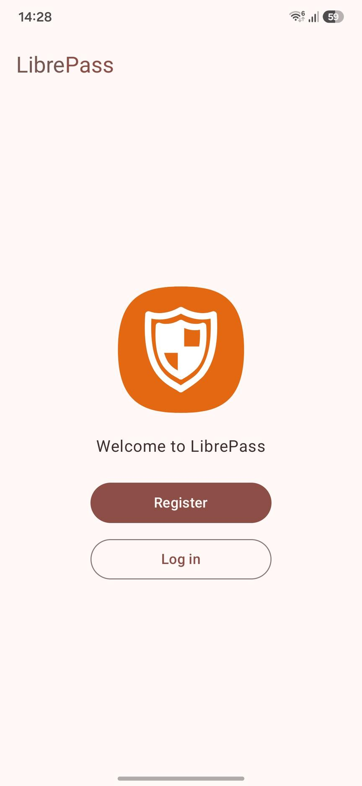
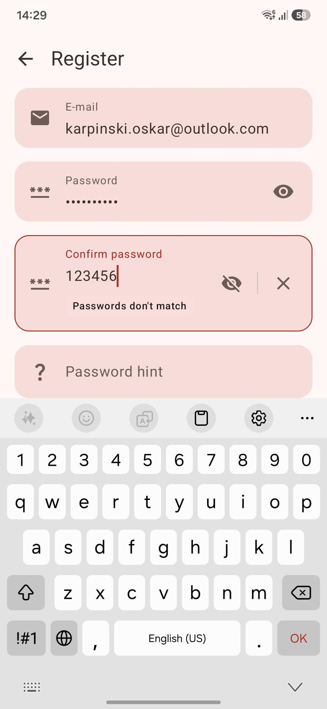
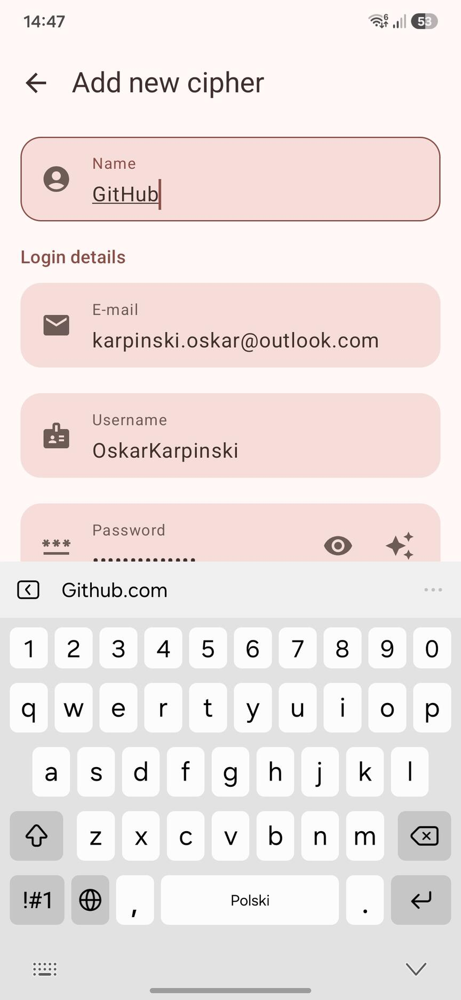
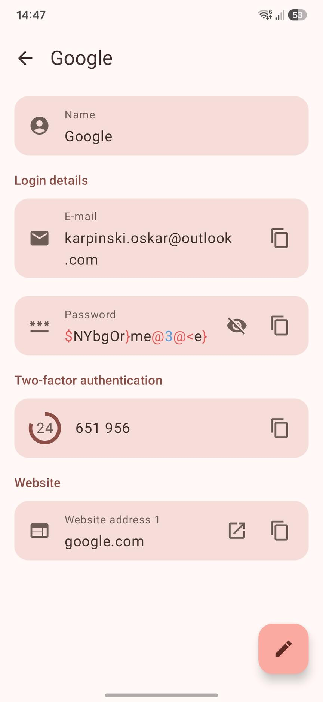
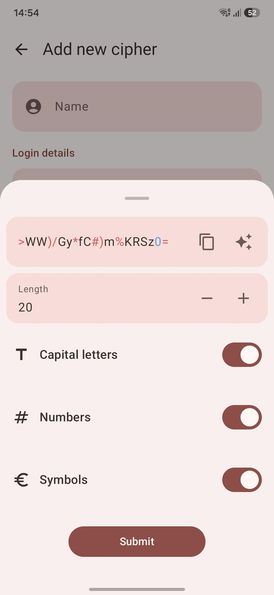

# LibrePass Android

> [!WARNING]  
> **Status: Unmaintained** — This project is no longer actively developed as of October 2024.

LibrePass Android is a cloud-based password manager built for Android with a focus on **simplicity, security, and performance**. The application provides a way to generate, manage, and synchronize passwords across devices. It is a **hobby project** — not audited for production use.

---

## ⚠️ Project Status

This project was a **hobby project** that served as a comprehensive learning experience. It taught me valuable lessons about:

- **Modern Android development** with Kotlin and Jetpack Compose
- **Cryptography and security** implementation in mobile applications (client-side encryption)
- **Cloud synchronization** and backend integration patterns
- **Clean architecture** and modular project structure
- **Multi-module Android projects** with feature separation
- **User authentication** and biometric security
- **Dependency injection** with Dagger Hilt

While the project is no longer maintained, the codebase remains a reference implementation for Android development practices.

---

## 📸 Screenshots

  
  
  
  
  

---

## 📱 Features

- ✅ **Client-Side Encryption** — Vault encrypted with AES-256-GCM (via `dev.medzik:libcrypto:1.2.0` / `dev.medzik.librepass:client:1.6.2`), key derived via Argon2id + X25519 (`Cryptography.kt:14,21`)
- ✅ **Password Generation** — Generate passwords with customizable length/charset (`CipherEditFields.kt:171`). Known limitation: uses `java.util.Random` (`CipherEditFields.kt:187`, not `SecureRandom`) and `CipherEditFields.kt:143` binds password field to `username` — see Security notes
- ✅ **Biometric Unlock** — `BIOMETRIC_STRONG` (face/fingerprint, Android 9+) via `Biometric.kt:21`, with auto-lock after configurable timeout (`VaultTimeout.kt:23` `INSTANT`–`NEVER`, `MainActivity.kt:95` `onPause`/`onResume`)
- ✅ **Cross-Device Synchronization** — Sync via `POST /api/cipher/sync` (`business/SyncCiphers.kt:27`); last-write-wins, no conflict merge
- ✅ **Material 3 Design** — Dynamic colors on Android 12+ (`Theme.kt:88` `dynamicDarkColorScheme`), Compose `1.6.8`, Material3 `1.2.1`
- ✅ **QR Code Integration** — Scan TOTP/HOTP via `zxing-android:4.3.0` (`QrScanner.kt:17`, `OtpConfigure.kt:152` supports `TOTP`/`HOTP`, `SHA1/256/512`)
- ✅ **Vault Auto-Lock** — Configurable inactivity lock
- ✅ **Dark Mode** — Full support via Material 3
- ✅ **Partial Offline Support** — View and add work offline via Room `LocalCipher.kt:16` `needUpload` flag; login and delete require network (`Login.kt:63`, `Vault.kt:214`), deletes not queued (`SyncCiphers.kt:27` `emptyList()` + `TODO`)
- ✅ **Multi-Language Support** — `values-*/` (`ar, de, hi, nb-rNO, pl, tr, vi`) + `generateLocaleConfig=true` (`app/build.gradle.kts:43`)

---

## 🛠️ Technology Stack

- **Kotlin 2.0.0**, **Compose 1.6.8**, **Material3 1.2.1**, **AGP 8.5.0**, `compileSdk 34`, `minSdk 24`
- **Multi-module**: `app`, `business-logic`, `common`, `database-logic` (`settings.gradle.kts:21`)
- **Jetpack**: Hilt `2.51.1` (`MainActivity.kt:28` `@AndroidEntryPoint`), Navigation `2.8.0`, Biometric `1.2.0-alpha05`, Lifecycle `2.8.2`, Room `2.6.1` (`Database.kt:6` `version=2`), DataStore `1.1.1` (`SecretsStore.kt:15` `aesKey` encrypted, `Credentials.kt:13` `apiKey/email` plain — known trade-off)
- **Crypto**: `dev.medzik.librepass:client:1.6.2`, `dev.medzik:libcrypto:1.2.0` (AES-GCM), `dev.medzik:otp:1.0.1`, `X25519` + `HSAuth` for auth
- **Other**: Coil `2.6.0`, ZXing `3.5.3`, Kotlin Coroutines `1.8.1`

---

## 📱 Availability

LibrePass Android was previously available on app stores but is **no longer maintained**:

- **F-Droid** — Previously available, removed due to project being unmaintained
- **IzzyOnDroid** — Previously available, removed due to project being unmaintained
- **GitHub Releases** — Historical releases (`1.3.1` `versionCode 18` `app/build.gradle.kts:20`) still available for reference. App shows deprecation dialog (`MainActivity.kt:59` `deprecated`).

---

## 🔐 Security

This application implements several security measures:

1. **Encrypted Storage** — Vault data encrypted with AES-256-GCM (key derived via Argon2id `X25519.computeSharedSecret` `Unlock.kt:94`); `aesKey` stored in `EncryptedDataStore` protected by `KeyStore` + biometrics, `Credentials` (`apiKey`) in Room plain — root can read
2. **Biometric Authentication** — `BIOMETRIC_STRONG` fingerprint/face (`Biometric.kt:37,69`)
3. **Automatic Vault Lock** — Configurable timeout (`VaultTimeout.kt:23`)
4. **HTTPS Communication** — `https://api.librepass.*` via `librepass:client`; `AndroidManifest` no `cleartextTraffic` (HTTPS by default), intended to be used behind Caddy/NGINX proxy terminating TLS on server side
5. **Logging** — Passwords not logged; **known issue**: TOTP secrets were logged via `Log.i("QR_SCANNER", scannedText)` `QrScanner.kt:23` and `OtpConfigure.kt:95` — should be removed for production

> **Note:** This is a hobby project. The password generator uses `java.util.Random` (`CipherEditFields.kt:187`) — not cryptographically secure — and the password field had a binding bug (`CipherEditFields.kt:147` `value=cipherData.username`). For production, use `SecureRandom`, fix the binding, remove `Log.i` for secrets, and queue deletes for offline. Consider a professional audit and an established password manager.

---

## 📄 License

This project is licensed under the **GNU General Public License v3.0** (GPL-3.0)

---

## 🔗 Related Projects

- **[LibrePass Server](https://github.com/LibrePass/LibrePass-Server)** — Backend of the LibrePass password manager (Spring Boot, serves HTTP behind Caddy TLS)

---

## 💡 What I Learned

This hobby project taught me invaluable lessons about:

### Android Development
- ✅ Modern Kotlin & Compose patterns for responsive UIs
- ✅ Multi-module Android architecture with clean separation of concerns (`app` → `common` → `businessLogic`/`databaseLogic`)
- ✅ Jetpack components (Hilt, Navigation, Biometric, Lifecycle, Room, DataStore)
- ✅ User authentication flows and biometric integration
- ✅ Material Design 3 and dynamic theming
- ✅ Performant Android apps with offline caching (Room `needUpload`)

### Cryptography & Security
- ✅ Client-side E2E encryption (Argon2id → X25519 → AES-256-GCM) and why server never sees plaintext
- ✅ Secure credential handling (Encrypted DataStore for `aesKey` vs. plain Room for `Credentials` trade-off)
- ✅ Biometric authentication and vault auto-lock
- ✅ HTTPS sync and the limits of offline-first without proper conflict resolution
- ✅ Password generation pitfalls (`Random` vs `SecureRandom`) and UI binding bugs

### Architecture & Best Practices
- ✅ Partial offline-first with `needUpload` queue and `lastSync` (`Credentials.kt:15`) — and why `SyncCiphers.kt:27` `TODO` for deletes matters
- ✅ Dependency injection with Dagger Hilt at scale
- ✅ Community localization and internationalization (7 locales)
- ✅ Multi-module Gradle organization

This project combined practical Android development with real-world security trade-offs of a hobby password manager.

---

**Built with ❤️ as a learning experience in Android development**
